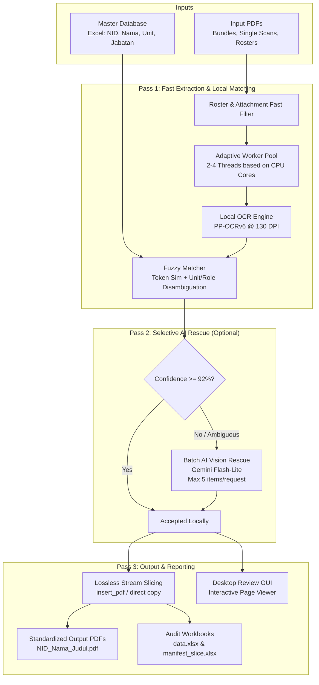

# Certificate Manager

High-throughput, local-first certificate processing system for automated PDF splitting, OCR text extraction, fuzzy employee database matching, and enterprise workbook generation.

---

## Overview

Organizations handling corporate trainings, technical certifications, and compliance licenses regularly receive hundreds of certificate files. These often arrive in irregular formats: multi-page bundles containing multiple recipients, two-page scanned certificates with unit competency syllabi on the reverse side, mixed transmittal letters (surat pengantar / roster tables), and accompanying auxiliary documents (attendance sheets, invoices).

**Certificate Manager** automates the entire processing lifecycle:
1. Deconstructs multi-page bundles into individual certificate documents.
2. Extracts recipient identity, certificate titles, numbers, and validity dates using a high-speed local OCR engine.
3. Performs fuzzy matching against an employee master database (Excel) with typo tolerance, patronymic handling, and unit/department disambiguation.
4. Categorizes transmittal letters and non-certificate attachments automatically.
5. Saves clean, standardized PDF files without re-compressing or degrading original document quality.
6. Produces comprehensive, audit-ready 16-column Excel workbooks and provides a standalone desktop review interface for human validation.

---

## Architecture and Pipeline

The application operates as a three-pass processing pipeline designed for speed, accuracy, and fault isolation:



### Pipeline Stages

1. **Document Deconstruction & Pre-filtering**:
   - Analyzes embedded digital text and file naming cues to instantly identify roster tables and transmittal letters without speculative OCR calls.
   - Accurately pairs front certificate pages with reverse syllabus/continuation pages.

2. **Parallel OCR & Local Resolution (Pass 1)**:
   - Uses an adaptive thread pool scaled to available CPU hardware (2 workers on entry-level dual/quad-core systems; 4 workers on 8+ core architectures).
   - Operates RapidOCR (PP-OCRv6 ONNX runtime) at an optimized 130 DPI threshold.
   - Evaluates recipient names against the master employee database using weighted Levenshtein ratios, token overlap, mononym detection, and organizational unit boosting.

3. **Selective Cloud AI Vision Rescue (Pass 2 - Optional)**:
   - For heavily distorted, low-contrast, or ambiguous scans where local fuzzy scoring is below threshold, an optional Google Gemini Flash-Lite rescue layer can be invoked.
   - Requests are batched (up to 5 documents per API call) to conserve quota and minimize network overhead.
   - Zero employee data is transmitted if this option is disabled; the system remains 100% offline.

4. **Lossless Finalization (Pass 3)**:
   - Extracted certificates are sliced using direct binary preservation (`shutil.copy2`) for single files or PyMuPDF object stream splicing (`insert_pdf`) for bundles. Original raster quality and vector fonts remain unaltered.
   - Generates dual Excel deliverables: `data.xlsx` (a formatted, human-readable 16-column report) and `manifest_slice.xlsx` (a structured audit ledger).

---

## Performance Benchmark

Benchmarked on an AMD Ryzen 7 7840HS (16 GB RAM) against a real-world batch of 25 scanned bitmap certificates (50 pages total, zero embedded digital text):

| Metric | Sequential Baseline | Certificate Manager (Optimized) |
|---|---|---|
| **Processing Time** | 225.0 seconds (3m 45s) | **25.06 seconds** |
| **Throughput** | ~0.11 files / second | **~1.00 file / second (9x speedup)** |
| **Validation Accuracy** | 25 / 25 matched (100%) | **25 / 25 matched (100%)** |
| **Review Required** | 0 items | **0 items** |
| **Output Image Quality** | Unchanged | **100% Lossless (Identical to source)** |

### Optimization Highlights
- **Elimination of Speculative OCR**: Pre-filtering prevents scanning non-roster documents repeatedly across preparation and candidate evaluation phases.
- **Front-Page Priority Execution**: Candidate resolution runs on page 0 first. Once verified with high confidence against the database, heavy reverse-side syllabus tables are not unnecessarily re-rasterized.
- **Sweet-Spot OCR Resolution**: Lowering OCR rendering from 200 DPI to 130 DPI reduces per-page inference latency from 2.4s to ~0.57s while preserving 100% text recognition accuracy.

---

## Key Features

- **Local-First & Privacy Compliant**: Designed to run entirely offline inside corporate intranets without sending confidential employee data to external endpoints.
- **Robust Fuzzy Matching**:
  - Handles Indonesian naming conventions (abbreviations like *M.*, *Moh.*, *Ach.*, patronymics like *Bin/Binti*, and spelling digraphs like *kh/ch/oe*).
  - Automatic disambiguation using workplace unit and job position keywords.
  - Mononym support for single-word names.
- **Smart Attachment Handling**:
  - Automatically identifies transmittal letters (Surat Pengantar), participant rosters, and auxiliary documents (attendance lists, invoices, rundowns).
  - Automatically prefixes non-certificate files with `[LAMPIRAN]` tags.
- **Desktop Review & Validation GUI**:
  - High-DPI aware Tkinter desktop interface with dark-mode accents.
  - Interactive PDF preview canvas supporting zoom, pan, and fit-to-width navigation.
  - One-click individual and batch approval workflows with live status badges.
- **Audit-Ready Excel Reports**:
  - Produces color-coded workbooks complete with NID, employee name, position, unit, document type, certificate title, number, issue date, expiry date, and validation status.

---

## Project Structure

```text
certificate-manager/
├── src/
│   └── certslice/
│       ├── __init__.py
│       ├── __main__.py          # CLI entry point
│       ├── bulk.py              # Unified batch processor, threading, & workbook generation
│       ├── config.py            # Configuration loader
│       ├── database.py          # Master employee Excel loader & alias resolution
│       ├── default_config.toml  # Default matching thresholds and regex patterns
│       ├── errors.py            # Custom exception types
│       ├── fields.py            # Regex extractors for titles, numbers, and dates
│       ├── gemini.py            # Optional Flash-Lite rescue layer & local settings
│       ├── grouping.py          # Multi-page continuation detection & bundling logic
│       ├── gui.py               # Tkinter desktop application & preview canvas
│       ├── matcher.py           # Multi-cue candidate scoring & decision matrix
│       ├── models.py            # Dataclasses (Employee, Candidate, CertJob, BulkItem)
│       ├── naming.py            # Output filename sanitization & formatting
│       ├── normalize.py         # Name folding, tokenization, & digraph normalization
│       ├── ocr.py               # RapidOCR engine wrapper
│       ├── pipeline.py          # Single-bundle slicing pipeline
│       └── reviewer.py          # Review storage, approval, and plan.json synchronization
├── templates/
│   └── sample_database.xlsx     # Sample mock employee dataset for testing
├── tests/
│   ├── acceptance/              # 170+ acceptance test suites
│   ├── fixtures/                # Mock PDF and Excel fixtures
│   └── unit/                    # Unit tests for bulk, matching, and OCR modules
├── scripts/
│   ├── run_check.py             # Guarded test runner with log capturing
│   ├── scan_secrets.py          # Automated repository secret scanner
│   └── stage_tests.py           # Multi-suite test coordinator
├── build_installer.py           # PyInstaller build automation script
├── Buka_Certificate_Manager.bat # Windows launcher shortcut
├── pyproject.toml               # Package metadata and build definitions
├── requirements.txt             # Pinned runtime dependencies
└── requirements-dev.txt         # Development and testing dependencies
```

---

## Installation

### Prerequisites
- Python 3.10 or higher
- Windows 10/11 (or Linux/macOS for CLI operations)

### 1. Clone the Repository
```bash
git clone https://github.com/DapppMC/certificate-manager.git
cd certificate-manager
```

### 2. Set Up Virtual Environment
```bash
python -m venv .venv
.\.venv\Scripts\activate   # On Windows
# source .venv/bin/activate # On Linux/macOS
```

### 3. Install Dependencies
```bash
pip install -r requirements.txt
pip install -e .
```

For development and running the test suite:
```bash
pip install -r requirements-dev.txt
```

---

## Usage

### Desktop Graphical Interface (Recommended)
Launch the desktop application via:
```bash
python -m certslice
```
or on Windows, double-click:
```text
Buka_Certificate_Manager.bat
```

1. Select input certificate PDF files or choose an entire folder.
2. Select your master employee database (`.xlsx`). You can test with `templates/sample_database.xlsx`.
3. Choose an output directory.
4. Click **Mulai Proses Sertifikat**.
5. Once completed, inspect results in the output folder or use the interactive review tab to inspect and approve flagged items.

### Command Line Interface (CLI)
Process a single bundle or directory via CLI:
```bash
python -m certslice run --pdf "path/to/certificates.pdf" --db "templates/sample_database.xlsx" --out "out/results"
```

---

## Building Standalone Windows Executable

To compile a portable Windows `.exe` that does not require Python on the target machine:
```bash
python build_installer.py
```
The compiled application and its dependencies will be generated in `dist/CertificateManager/CertificateManager.exe`.

---

## Testing & Quality Assurance

The codebase includes an extensive automated test suite covering edge cases, mononyms, inverted names, continuation logic, OCR pipelines, and output contracts:

```bash
python scripts/run_check.py --name all -- python scripts/stage_tests.py --all
```

Run secret scanning:
```bash
python scripts/run_check.py --name secrets -- python scripts/scan_secrets.py
```

---

## Privacy and Security

- **Zero Data Leakage**: By default, no network calls are initiated. All OCR models and fuzzy matching algorithms execute locally on your CPU/GPU.
- **Safe Handling of Personal Data**: No employee credentials, national IDs, or sensitive corporate records are committed to version control. The repository includes an automated secret scanner (`scripts/scan_secrets.py`) to enforce safety standards.

---

## License

This project is licensed under the MIT License. See the [LICENSE](LICENSE) file for details.
