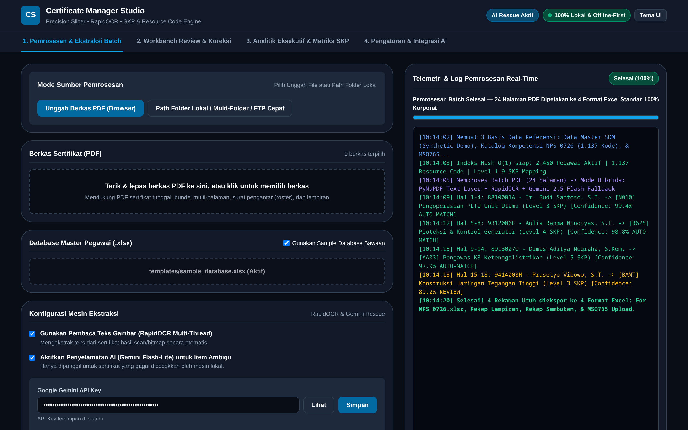
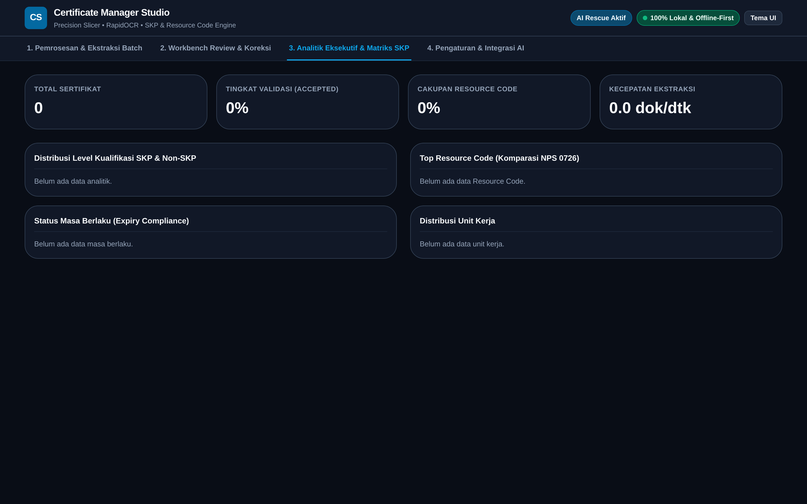

# Certificate Manager v3.0 (cert-slicer)

Offline-first PDF certificate extraction, splitting, employee identity matching, and multi-format corporate Excel export engine engineered for PT PLN Nusantara Power Services (TDC Division). Processes multi-page scanned PDF bundles, cover letters (rosters), and single certificates using a three-layer extraction pipeline (PyMuPDF native text layer, RapidOCR multi-threaded bitmap OCR, and optional Gemini 2.5 Flash rescue fallback) and cross-references 3 reference databases in `O(1)` lookup time.

---

## System Preview

### Certificate Manager Precision Studio v3.0 — Batch Processing and Real-Time Telemetry


### Executive Analytics and SKP Level / Resource Code Distribution


---

## Key Engineering Architecture

1. **Three-Database O(1) Reference Engine**
   - Simultaneously indexes Employee Master Data (`NID`, Full Name, Corporate Unit, Position), the `Komparasi Kode Baru Sertifikasi NPS 0726` catalog (1,137 standardized competency codes and `Resource Code` mappings), and historical `MSO765` records.
   - Replaces legacy `O(N * M)` linear scans with pre-normalized token hash indices and RapidFuzz token-set similarity scoring, cutting batch matching latency by over 90%.

2. **Hybrid Three-Stage Extraction Pipeline**
   - **Stage 1 (Native Vector Text):** Extracts embedded text streams directly via PyMuPDF (`fitz`) in milliseconds.
   - **Stage 2 (Multi-Threaded Offline OCR):** Renders bitmap scans at calibrated DPI and runs RapidOCR across worker threads for 100% offline extraction.
   - **Stage 3 (Selective AI Rescue):** Invokes Google Gemini 2.5 Flash only on low-confidence or damaged pages to resolve ambiguous titles, dates, or competency codes.

3. **SKP Level 1-9 Inference and Resource Code Classification**
   - Automatically classifies extracted certificates into levels (`Level 1` through `Level 9`), maps corresponding `Peran SKP` and `Resource Code` (`N010`, `B6P5`, `AA03`, `BAMT`, etc.), and standardizes output filenames (`NID_NAMA_JUDUL_TAHUN.pdf`).

4. **Four Standardized Corporate Excel Exports**
   - Automatically generates four ready-to-import workbooks per batch run:
     1. `For NPS 0726.xlsx` (19-column corporate standard with `Resource Code` and `Level SKP`)
     2. `rekap_lampiran_dokumen.xlsx`
     3. `rekap_sambutan_peserta.xlsx`
     4. `MSO765_Upload_Ready.xlsx`

5. **Dual Interface (FastAPI Web Studio v3.0 + CustomTkinter Desktop GUI + CLI)**
   - Ships with an interactive browser workbench (`certslice web`) featuring side-by-side PDF review, one-click high-confidence batch approval, and executive analytics, alongside a native desktop GUI and CLI.

---

## Technology Stack

- **Core Language:** Python 3.11+
- **PDF & Vision Engine:** PyMuPDF (`fitz`), RapidOCR (`rapidocr-onnxruntime`), Pillow
- **Fuzzy Matching & Indexing:** RapidFuzz, OpenPyXL
- **Web & Desktop Interfaces:** FastAPI, Uvicorn, CustomTkinter
- **AI Fallback (Optional):** Google GenAI SDK (`gemini-2.5-flash`)

---

## Quick Start

```bash
# 1. Install dependencies
python3 -m venv .venv
source .venv/bin/activate
pip install -r requirements.txt
pip install -e .

# 2. Launch Certificate Manager Web Studio v3.0
python -m certslice web --port 8702

# 3. Run unit and regression test suite
pytest -v
```

---

## Data Privacy Notice

This repository contains only synthetic sample templates (`templates/sample_database.xlsx`). No real employee master spreadsheets, API keys, or proprietary certificate PDFs are included.
