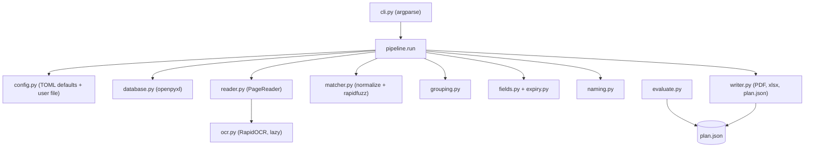

# Design

## Summary
A local Python command-line engine reads a bundle PDF page by page (text layer first, bundled OCR second), finds the holder on each page by searching the database names in the page text, decides conservatively, groups pages into certificates, extracts the other fields with layout-free rules, and writes named PDFs plus two workbooks. Everything is decided in a plan first (plan.json); writing happens only after the plan passes the page-accounting check. The main trade-off: no templates and no LLM in M1, so NID and name are strong while title, issuer and dates carry a confidence and go to "needs review" when unsure. Exact contracts: [interface](modules/interface.md); exact rules: [extraction rules](modules/extraction-rules.md).

## Architecture

## Components
| Component | Responsibility | Tech (pinned) | Serves |
|-----------|----------------|---------------|--------|
| `cli.py`, `__main__.py` | parse arguments, call pipeline or evaluate, map errors to exit codes, print summary lines | argparse (stdlib) | R-09, R-19 |
| `errors.py` | `InputError`, `AccountingError` | stdlib | R-13, R-19 |
| `config.py` | load `default_config.toml`, merge `--config`, load alias CSV | tomllib, csv (stdlib) | R-07, R-16 |
| `models.py` | `PageText`, `PageReader`, `Employee`, `Candidate`, `Group` dataclasses | dataclasses | R-17 |
| `database.py` | find header row, map columns, NID as text, validate | openpyxl 3.1.5 | R-01, R-19 |
| `normalize.py` | name normalisation and folding helpers | unicodedata, re | R-03 |
| `reader.py` | open PDF (errors for corrupt/encrypted/empty), `LocalPageReader` (text layer, OCR fallback) | PyMuPDF 1.28.2 | R-01, R-02, R-17, R-19 |
| `ocr.py` | one lazy RapidOCR engine, timing | rapidocr 3.10.0, onnxruntime 1.31.0 | R-02, R-20 |
| `matcher.py` | candidates, template names, cue filter, decision | rapidfuzz 3.14.6 | R-03, R-04, R-08 |
| `grouping.py` | auto and fixed grouping, accounting check | stdlib | R-05, R-13 |
| `fields.py`, `expiry.py` | number, dates, title, issuer, type, renewal, expiry rules, confidence | re, datetime | R-06, R-07, R-15 |
| `naming.py` | clean fields, aliases, path length, duplicates | stdlib | R-10, R-16, R-21 |
| `writer.py` | run folder, split PDFs, manifest, report, plan.json | PyMuPDF, openpyxl, json | R-09, R-11, R-12, R-14, R-15 |
| `pipeline.py` | orchestrates the stages, timings | stdlib | R-09, R-13, R-17, R-20 |
| `evaluate.py` | gold-set scoring | csv, rapidfuzz | R-18 |

## Data and storage
- Inputs: one PDF and one xlsx, read-only. Nothing is written next to them.
- Outputs: a new run folder per run under `--out` (layout in [interface](modules/interface.md) section 4). plan.json is the single source for the workbooks and for `evaluate`.
- Config: `src/certslice/default_config.toml` (protected) plus an optional user TOML and alias CSV.
- Real data lives only in `samples/` (gitignored) and in user-chosen folders; tests use `tests/fixtures/` (synthetic, made by `scripts/make_fixtures.py`).
- No database, no network, no cache in M1.

## Key decisions
- Scope and milestones -> [ADR-001](decisions/ADR-001-scope-tier-milestones.md)
- Template-free, local-first extraction -> [ADR-002](decisions/ADR-002-local-first-template-free-extraction.md)
- Conservative matching and page accounting -> [ADR-003](decisions/ADR-003-conservative-matching-and-page-accounting.md)
- Stack and distribution -> [ADR-004](decisions/ADR-004-stack-and-distribution.md)
- Optional LLM layer and data policy -> [ADR-005](decisions/ADR-005-optional-llm-layer-and-data-policy.md)
- Plan-first pipeline and file contracts -> [ADR-006](decisions/ADR-006-plan-first-pipeline-and-contracts.md)
- Planner-owned acceptance tests and synthetic fixtures -> [ADR-007](decisions/ADR-007-planner-owned-acceptance-tests.md)
- Rules tuned on the real master data and two real bundles -> [ADR-008](decisions/ADR-008-rules-tuned-on-real-samples.md)

## Cross-cutting
- Security and privacy: no network calls in M1 (an acceptance test blocks sockets); no secrets exist in M1; `samples/`, run outputs and `.env` are gitignored; database.xlsx is never copied or uploaded. Baseline: tooling-planner security baseline.
- Errors and logging: input problems stop before writing (exit 2) with one plain-language `ERROR:` line; logging goes to stderr through `logging` at INFO; no employee data in log lines beyond page numbers and NIDs already in the outputs; RapidOCR's own logger is set to WARNING.
- Cost and limits: Rp0; CPU only; OCR about 3.5 s per page on real scans in the planner sandbox (Windows unmeasured); matching 5,088 employees is about 1 s per text page in plain Python.
- Observability: plan.json timings and candidate scores explain every decision; `evaluate` measures accuracy.

## Environments and deployment
- Development: Windows 11, Python 3.13.13, a `.venv` in the repo, packages from `requirements.txt` (pinned) and `requirements-dev.txt`; editable install `pip install -e .`.
- M2 (outline): PyInstaller 6.22.3 one-folder build with RapidOCR models, Inno Setup installer, portable zip fallback, clean-Windows test. Planned when M1 passes the gold set.

## Risks and trade-offs
- Real certificates may break the generic field rules -> per-field confidence, needs-review sheet, gold set, M3 rescue (brief risk 3).
- Signatory in the database -> template-name and cue filters (brief risk 2).
- OCR on poor scans -> spike T-017 before building OCR (brief risk 4).

## Out of scope
- Local LLMs, Docker in the product, upload to the monitoring web, renewal detection from history, interactive review in the app, GPU use; resume of interrupted runs (M3).

Related: [requirements](01-requirements.md), [brief](00-brief.md), [workflows](03-workflows.md), [tooling](05-tooling.md)
