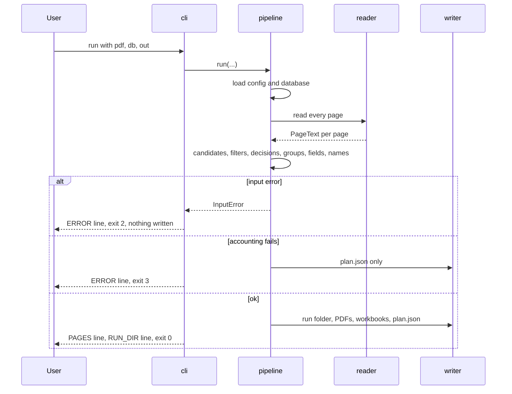

# Core workflows

## Flow 1: process a bundle (serves R-01 to R-16, R-19 to R-22)
Trigger: `python -m certslice run --pdf ... --db ... --out ...`. Actor: TDC staff or the project owner. Preconditions: Python environment installed.

| Step | Actor | Action | Result |
|------|-------|--------|--------|
| 1 | pipeline | check files exist, load config, load database (header search, column map) | employees list or InputError |
| 2 | reader | open PDF (corrupt, encrypted, empty -> InputError); read each page, OCR when no text | PageText per page |
| 3 | matcher | candidates per page; template names; cue filter; decision | start pages and decisions |
| 4 | grouping | auto or fixed grouping; accounting check | groups |
| 5 | fields | number, dates, expiry rule, title, issuer, type, renewal, confidence | fields per group |
| 6 | naming | file names, path-length check (InputError if the out path is too long) | names |
| 7 | writer | create run folder; split PDFs; manifest; report; plan.json | outputs |

Errors and edge cases: unknown holder, homonym or close candidates -> report row, never a guess; a page with no text and OCR off -> report row `no text`; a duplicate name -> `_dup2`; a second run -> a new run folder.

## Flow 2: dry run (serves R-09)
Same as Flow 1 up to step 6, then the run folder gets plan.json only. The user opens plan.json (or reruns without `--dry-run`).

## Flow 3: evaluate against a gold set (serves R-18)
Trigger: `python -m certslice evaluate --run <run folder> --gold samples/gold.csv`. Steps: read plan.json, read gold rows, match each row to the group starting at its page, count wrong NIDs, correct certificates and per-field matches, split text and scan, print the lines, exit 4 when a wrong NID exists. Errors: missing plan.json or gold file -> `ERROR:` line, exit 2.

## Flow 4: real-data pilot (human, serves the success metrics)
The owner puts real bundles and database in `samples/`, fills `samples/gold.csv` (template `templates/gold.template.csv`), runs Flow 1 and Flow 3 on each bundle, and pastes the `SET`, `FIELD` and `WRONG_NID` lines to the planner. The kill criteria in the brief are checked on these numbers.

Related: [design](02-design.md), [requirements](01-requirements.md), [interface](modules/interface.md)
