# Gate 2: Architecture & Anti-Slop Design Specification

## 1. Surface Classification (`DESIGN_CONSTITUTION.md` Layer 0)
- **Mode:** **MODE A: WORKSPACE / UTILITY** (High-density Certificate Processing Studio, Interactive Document Inspector, Audit Ledger & MSO765 Telemetry).
- **Archetype:** **Archetype 1: Precision Dark** (`--bg-canvas: #09090B; --bg-surface: #121215; --bg-elevated: #18181C; --border-subtle: rgba(255,255,255,0.07); --accent: #0EA5E9; --accent-emerald: #10B981; --accent-amber: #F59E0B`) with clean high-contrast tokens (`>= 4.5:1` WCAG AA / APCA $L_c \ge 75$).
- **Concentric Geometry:** Outer cards use `--radius-outer: calc(var(--radius-inner) + var(--pad-card))` (`16px = 8px + 8px`).
- **Tabular Numerals:** All counters, scores, NIDs, dates, resource codes, and table cells enforce `font-variant-numeric: tabular-nums`.
- **Zero External CDN:** Pure self-contained CSS + SVG iconography so the Web UI works 100% offline.

## 2. Algorithmic & Systems Architecture

```mermaid
flowchart LR
    subgraph CacheLayer["In-Memory Index & Cache Layer"]
        DBCache["Employee DB Cache\n(mtime_ns + size key)"]
        EmpIndex["Pre-computed EmployeeIndex\n(Tokens, Length Bounds, Norms)"]
        RCCache["ResourceCodeCatalog\n(Komparasi NPS 0726)"]
        OCRPool["Thread-Local RapidOCR\n(Lock-Free Parallel Inference)"]
    end

    subgraph Engine["Core Processing Engine"]
        Prep["Single-Pass PDF Inspector\n(Page Count + Text Cache)"]
        Match["Vectorized Matcher\n(RapidFuzz cdist + Pruning)"]
        Fields["Pre-compiled Regex Extractor\n(SKP Level, Peran, Dates)"]
        Writer["Lossless PDF Slicer &\nWorkbook Generator"]
    end

    subgraph Surfaces["User Interfaces"]
        CLI["CLI (certslice run / evaluate)"]
        Web["Web Studio v3.0 (FastAPI)\nUpload + Local Folder + FTP + Analytics"]
        GUI["Desktop GUI v3.0 (Tkinter)\nHotkeys + Search + Web Bridge"]
    end

    CacheLayer --> Engine
    Engine --> Surfaces
```

## 3. Port Allocation (MASP Compliance)
- Default Web Server supports MASP AG6 port `8500` (with CLI `--port` override and backwards-compatible fallback).
